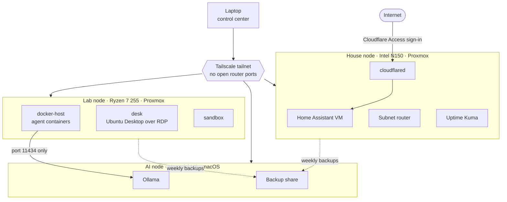

# Homelab

A remote-first, security-first home server setup. Four machines, one job each, all managed from a laptop over a private network. Only one service is reachable from the internet, and it sits behind an identity check. Cameras, entry readers and smart-home devices live on their own networks, away from the servers.

This repo holds the build plan, the reasoning behind each decision, and the scripts and configs that implement it.

## Architecture



| Node | Hardware | OS | Job |
| --- | --- | --- | --- |
| Laptop | MacBook | macOS | Control center: SSH, Proxmox web UI, RDP, Screen Sharing |
| House node (`pve-house`) | Intel N150 mini PC, 16 GB, 256 GB SSD | Proxmox VE 9 | Home Assistant, Cloudflare tunnel, Tailscale subnet router, monitoring |
| Lab node (`pve-lab`) | Minisforum X1 Lite, Ryzen 7 255, 32 GB DDR5, 1 TB NVMe | Proxmox VE 9 | VMs for containers and AI agents, a remote desktop, a sandbox |
| AI node (`mac-mini`) | Mac mini, Apple M6, 32 GB unified memory | macOS 26 | Local LLM inference with Ollama, backup target |

The network is UniFi: a Dream Machine Pro gateway, a Pro 24 PoE switch, four Wi-Fi 7 access points, six Protect cameras and doorbells, and an Access Hub for the door locks.

More detail: [architecture](docs/architecture.md) · [hardware](docs/hardware.md) · [network](docs/network.md) · [security model](docs/security-model.md)

## Design principles

1. **Remote-first.** Every node runs headless. After setup, nothing needs a monitor.
2. **Private by default.** All admin access goes over Tailscale. The router has zero port forwards.
3. **One public door.** Home Assistant is published through a Cloudflare Tunnel, with Cloudflare Access in front of it.
4. **Contain the agents.** AI agents run in their own VM, as non-root containers, and can reach only the model server's port.
5. **Phishing-resistant MFA.** Hardware security keys (WebAuthn) wherever a service supports them.
6. **Recoverable from anywhere.** Automatic power-on, remote disk unlock, a second network path in, and cross-machine backups.

## Build order

| Phase | Guide | Time | Done when |
| --- | --- | --- | --- |
| 0 | [Prep](docs/build/00-prep.md) | 30 min | Installers ready, accounts made, LAN range known |
| 1 | [House node](docs/build/01-house-node.md) | 1 hr | Subnet router live, Home Assistant behind Cloudflare Access |
| 2 | [Lab node](docs/build/02-lab-node.md) | 1 to 1.5 hr | Proxmox web UI opens over Tailscale with a hardware key |
| 3 | [Lab VMs](docs/build/03-lab-vms.md) | 2 hr | docker-host and desk running and snapshotted |
| 4 | [Mac mini](docs/build/04-mac-mini.md) | 1 hr | Screen Sharing works remotely, Ollama answers on port 11434 |
| 5 | [Wire it together](docs/build/05-wire-together.md) | 2 hr | Access rules, backups and alerts in place |
| 6 | [Offsite checklist](docs/build/06-offsite-checklist.md) | 30 min | Every check passes from outside the house |
| 7 | [Network segmentation](docs/build/07-network-segmentation.md) | 2 hr | Every device on its planned network, and the offsite checklist passes again |

When something breaks: [recovery runbooks](docs/recovery.md) · [backups](docs/backups.md) · [gotchas](docs/gotchas.md)

## Decisions

Each major choice is written up as an [architecture decision record](docs/decisions/README.md).

| ADR | Decision |
| --- | --- |
| [0001](docs/decisions/0001-remote-first-headless-nodes.md) | Remote-first, headless nodes |
| [0002](docs/decisions/0002-proxmox-on-both-x86-nodes.md) | Proxmox VE on both x86 nodes |
| [0003](docs/decisions/0003-qubes-os-rejected.md) | Qubes OS considered and rejected |
| [0004](docs/decisions/0004-home-assistant-stays-on-house-node.md) | Home Assistant stays on its own low-power node |
| [0005](docs/decisions/0005-tailscale-for-private-access.md) | Tailscale for all private access |
| [0006](docs/decisions/0006-cloudflare-tunnel-only-for-home-assistant.md) | Cloudflare Tunnel only for Home Assistant, behind Access |
| [0007](docs/decisions/0007-no-two-node-cluster.md) | No two-node Proxmox cluster |
| [0008](docs/decisions/0008-local-llms-on-apple-silicon.md) | Local LLM inference on Apple Silicon |
| [0009](docs/decisions/0009-hardware-security-keys.md) | Hardware security keys for MFA |
| [0010](docs/decisions/0010-ubuntu-lts-for-vms.md) | Ubuntu 26.04 LTS for the VMs |
| [0011](docs/decisions/0011-network-segmentation.md) | Segment the network with VLANs on the UniFi gateway |

## Repository layout

```text
.
├── README.md
├── docs/
│   ├── architecture.md          nodes, network paths, resource budget
│   ├── hardware.md              bill of materials and hardware notes
│   ├── network.md               UniFi gear, power budget, network plan
│   ├── security-model.md        threats and the controls that answer them
│   ├── backups.md               what is backed up, where, how often
│   ├── recovery.md              runbooks for outages and lost devices
│   ├── gotchas.md               things that bit during the build
│   ├── build/                   phase-by-phase build guides
│   └── decisions/               architecture decision records
├── tailscale/policy.hujson      tailnet access rules, with tests
├── proxmox/create-vms.sh        creates the lab VMs with consistent settings
├── scripts/                     host and VM setup scripts
├── docker/agent-template/       hardened Compose template for agent containers
└── .github/workflows/lint.yml   ShellCheck on every push
```

## Roadmap

- [ ] Make Ollama's network binding survive reboots (launchd)
- [ ] Encrypted offsite copy of backups
- [ ] A separate UniFi NVR, so camera footage survives a drive failure
- [ ] Decide whether to build the optional Whonix VMs
- [ ] Proxmox Backup Server for deduplicated, verified backups

## Using this repo

These are notes from a real build, not a turnkey installer. Read every script before you run it, especially anything that runs as root. Values like `192.168.1.0/24`, `pve-house` and `100.x.y.z` are placeholders for your own.

Written for Proxmox VE 9, Ubuntu 26.04 LTS, macOS 26, the Tailscale Personal plan and UniFi Network 9 or later.

## References

- [Tailscale subnet routers](https://tailscale.com/kb/1019/subnets)
- [Tailscale on a Proxmox host](https://tailscale.com/kb/1133/proxmox)
- [Remote FileVault unlock over SSH in macOS 26](https://www.jeffgeerling.com/blog/2025/you-can-finally-manage-macs-filevault-remotely-tahoe/)
- [Home Assistant OS in a virtual machine](https://www.home-assistant.io/installation/Linux)
- [Install Docker Engine on Ubuntu](https://docs.docker.com/engine/install/ubuntu/)
- [UniFi zone-based firewall](https://help.ui.com/hc/en-us/articles/115003173168)

## License

[MIT](LICENSE)
