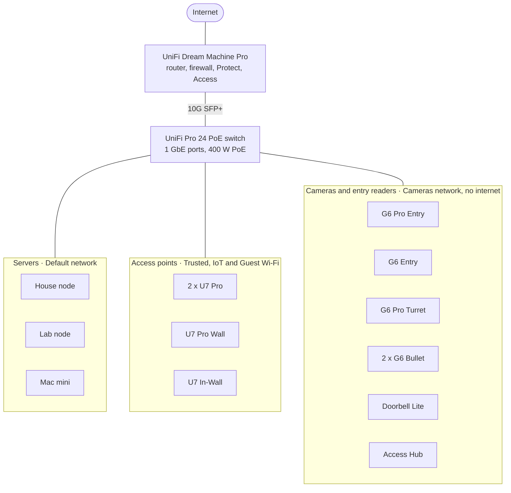

# Network

One UniFi Dream Machine Pro routes and firewalls all traffic, records the cameras and runs door access. Everything wired plugs into one 24-port PoE switch, which also powers the cameras, the entry readers and the Wi-Fi access points.

Network names are the [network plan](#network-plan) from Phase 7. Until then, everything shares the default network.

## Inventory

| Role | Model | Count | Max power each | Notes |
| --- | --- | --- | --- | --- |
| Gateway | UniFi Dream Machine Pro | 1 | Wall outlet | Router, firewall, Wi-Fi controller, Protect recorder with one drive bay, Access controller |
| Switch | UniFi Pro 24 PoE | 1 | Wall outlet | 24 x 1 GbE (16 PoE+, 8 PoE++), 2 x 10G SFP+, 400 W PoE budget |
| Doorbell and entry reader | UniFi G6 Pro Entry | 1 | 18 W, PoE+ | 12 MP camera, package camera, touchscreen, face, NFC and PIN unlock |
| Entry reader | UniFi G6 Entry | 1 | 16 W, PoE+ | 5 MP camera, package camera, face and NFC unlock |
| Camera | UniFi G6 Pro Turret | 1 | 15 W, PoE+ | 4K, 2.36x optical zoom |
| Camera | UniFi G6 Bullet | 2 | About 12 W | 4K |
| Doorbell | UniFi Doorbell Lite | 1 | 8 W, PoE | 5 MP, two-way audio, no package camera |
| Door hub | UniFi Access Hub | 1 | PoE on most models | Drives the lock at the door it's wired to. That door's reader plugs into the hub |
| Access point | UniFi U7 Pro | 2 | 21 W, PoE+ | Wi-Fi 7 with 6 GHz, 2.5 GbE uplink |
| Access point | UniFi U7 Pro Wall | 1 | 22 W, PoE+ | Wi-Fi 7 with 6 GHz, 2.5 GbE uplink |
| Access point | UniFi U7 In-Wall | 1 | 13 W | Wi-Fi 7 without 6 GHz, 2.5 GbE uplink, two extra wired ports |

## What this means for the build

- **The PoE budget is fine.** The ten powered devices and the Access Hub draw about 170 W at most, well under the switch's 400 W.
- **Everything wired runs at 1 GbE.** The switch's copper ports are all gigabit, so the 2.5 GbE ports on the access points, the lab node and the Mac mini link at 1 Gbps. A 2.5 GbE switch is the upgrade if backups or Wi-Fi 7 ever feel slow.
- **The switch connects to the gateway over 10G SFP+.** After Phase 7, traffic between networks passes through the gateway, where a gigabit uplink would be the bottleneck.
- **The gateway is at its comfortable camera load.** Ubiquiti [rates it for eight 4K cameras](https://itproexpert.com/?p=5142), and [installers report it stays smooth up to about four to six](https://keystoneintegration.pages.dev/blog/cloud-gateway-vs-unvr-12-camera-home). This setup has six: three 4K cameras, two entry readers with two cameras each, and a 5 MP doorbell. Watch its CPU, especially with intrusion prevention on.
- **Recordings have no redundancy.** The gateway has one drive bay, so a failed drive loses the footage, and a gateway reboot leaves a gap. A separate UniFi NVR is the upgrade if cameras are added.
- **Unlocking runs through the Access Hub.** [A reader can unlock only when it's cabled directly to a hub](https://help.ui.com/hc/en-us/articles/25849483463959), and [most hub models control a single door](https://ui.com/door-access/control-hubs). A second door needs its own hub, or the Enterprise Access Hub. Without a hub, a reader still rings and records.

## Network plan

[Phase 7](build/07-network-segmentation.md) splits the flat network into five. The servers stay on the default network, so no server address, DHCP reservation or Tailscale route changes ([ADR 0011](decisions/0011-network-segmentation.md)).

| Network | VLAN | Example subnet | What goes on it | Wi-Fi |
| --- | --- | --- | --- | --- |
| Default | 1 | `192.168.1.0/24` | Gateway, switch, access points, the three servers | None |
| Trusted | 20 | `192.168.20.0/24` | Laptops and phones | Main Wi-Fi |
| IoT | 30 | `192.168.30.0/24` | Smart-home devices, TVs, speakers | IoT Wi-Fi, with WPA2 and 2.4 GHz allowed |
| Cameras | 40 | `192.168.40.0/24` | Cameras, doorbells, entry readers, the Access Hub | None |
| Guest | 50 | `192.168.50.0/24` | Visitors | Guest Wi-Fi, with client isolation |

### Firewall rules

These go into UniFi's [zone-based firewall](https://help.ui.com/hc/en-us/articles/115003173168).

| From | To | Rule |
| --- | --- | --- |
| Trusted | Everything | Allow |
| Default (servers) | IoT | Allow, so Home Assistant can control devices |
| IoT | Internet | Allow |
| IoT | Home Assistant, on the ports an integration needs | Allow, only for devices that push to Home Assistant |
| IoT | Anything else on the network | Block, except replies |
| Cameras | Gateway | Allow |
| Cameras | Internet and everything else | Block |
| Guest | Internet | Allow |
| Guest | Anything else | Block |

### Switch ports

UniFi switch ports accept every VLAN by default. [Tagged VLAN Management](https://help.ui.com/hc/en-us/articles/26136855808919) set to **Block All** limits a port to its native network.

| Port | Native network | Tagged VLAN Management | Why |
| --- | --- | --- | --- |
| Uplink to the gateway | Default | Allow All | Carries every network |
| Access points | Default | Allow All | Carry the Wi-Fi networks |
| Servers | Default | Block All | A compromised VM can't tag its traffic onto another network |
| Cameras, doorbells, readers and the Access Hub | Cameras | Block All | A laptop plugged into an outdoor cable reaches only the gateway |

## Home Assistant

Official integrations cover [UniFi Protect](https://www.home-assistant.io/integrations/unifiprotect) (cameras, doorbell rings, detections) and [UniFi Access](https://www.home-assistant.io/integrations/unifi_access/) (unlocking, door status, doorbell events). Both talk to the gateway rather than the devices, so Home Assistant never needs a path into the Cameras network. Neither supports Early Access firmware, so keep the console on the official release channel.

## Remote access

- **Tailscale.** The house node's subnet route covers the default network, which is where the gateway and servers live, so it keeps working after Phase 7. To reach another network remotely, advertise its subnet too and allow it in the firewall.
- **UniFi remote access.** Away from home, the Protect and UniFi apps reach the console through Ubiquiti's cloud. Turning that off means a stolen UniFi account can't reach the console from the internet. Manage it over Tailscale instead, at the cost of some app convenience.
